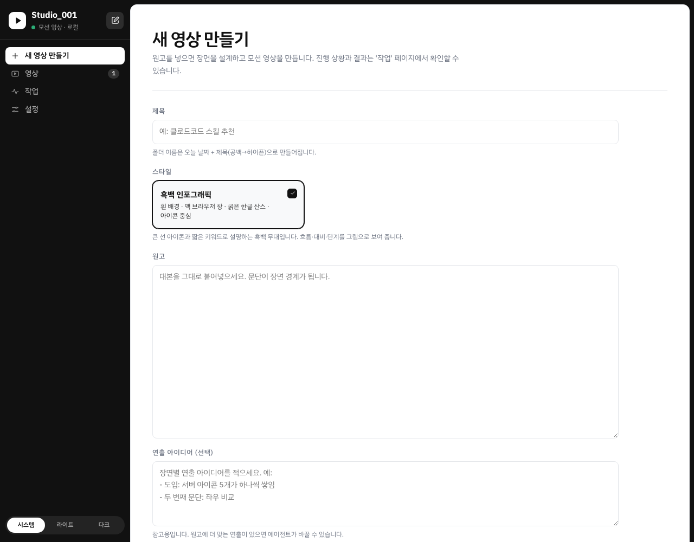

# PART3_Motion (Studio_001)

원고를 넣으면 흑백 인포그래픽 모션 영상을 만들어 주는 로컬 스튜디오입니다.

내 컴퓨터에서 바로 돌아갑니다.


<br>

## 먼저 설치할 것

1. [Node.js](https://nodejs.org) (버전 20 이상)

2. [Claude Code](https://claude.com/claude-code) 또는 [Codex](https://openai.com/codex)

   둘 중 하나를 설치한 뒤 로그인까지 해 둡니다.

<br>

## 1. 받기

터미널을 엽니다.

아래 두 줄을 한 줄씩 넣습니다.

```bash
git clone https://github.com/rainvibecode-blip/PART3_Motion.git
```

```bash
cd PART3_Motion
```

<br>

## 2. 켜기

아래 두 방법 중 편한 쪽으로 켭니다.

- **macOS 바로가기**: 폴더 안의 `Studio_001.command`를 더블클릭합니다. 서버가 켜지고 브라우저가 자동으로 열립니다.
- **터미널**: 아래 명령을 넣은 뒤 브라우저에서 `http://localhost:3000`을 엽니다.

```bash
bash start.sh
```

다른 포트를 쓰려면 `PORT=5000 bash start.sh`처럼 실행합니다.

<br>

## 3. 글 넣기

**새 영상 만들기** 화면에서 제목을 씁니다.

원고를 붙여 넣습니다.

**만들기 시작**을 누릅니다.



<br>

## 4. 기다리기

**작업** 화면에 진행 상황이 나옵니다.

짧은 글은 2~3분 걸립니다.

처음 한 번은 영상 엔진(Remotion)과 렌더용 브라우저를 내려받아 몇 분 더 걸립니다.

중간에 멈추려면 **작업** 화면에서 **취소**를 누릅니다.


<br>

## 5. 영상 보기

**영상** 화면에서 재생합니다.

**이 파일 받기**를 누르면 영상을 저장합니다.

<br>

## 6. 고치기

영상 화면 아래 **수정 요청** 칸에 고칠 내용을 글로 씁니다.

**수정 시작**을 누릅니다.

예: `두 번째 장면의 아이콘을 서버로 바꾸고, 마지막 장면을 3초 더 길게`

<br>

## 7. 엔진 바꾸기

기본 실행 엔진은 **Claude Code**입니다.

**Codex**를 쓰려면 왼쪽 메뉴의 **설정**에서 기본 실행 엔진을 **Codex**로 바꿉니다.

<br>

## 끄기

서버가 켜진 터미널 창에서 `Ctrl` + `C`를 누릅니다.

<br>

## 자주 묻는 것

**돈이 드나요?**

따로 들지 않습니다. 내 Claude Code 또는 Codex 로그인을 그대로 씁니다.

**만든 영상은 어디에 있나요?**

`videos` 폴더 안, `날짜_제목` 폴더의 `output`에 있습니다.

**마음대로 고쳐도 되나요?**

됩니다. MIT 라이선스이므로 자유롭게 쓰고 고칠 수 있습니다.
