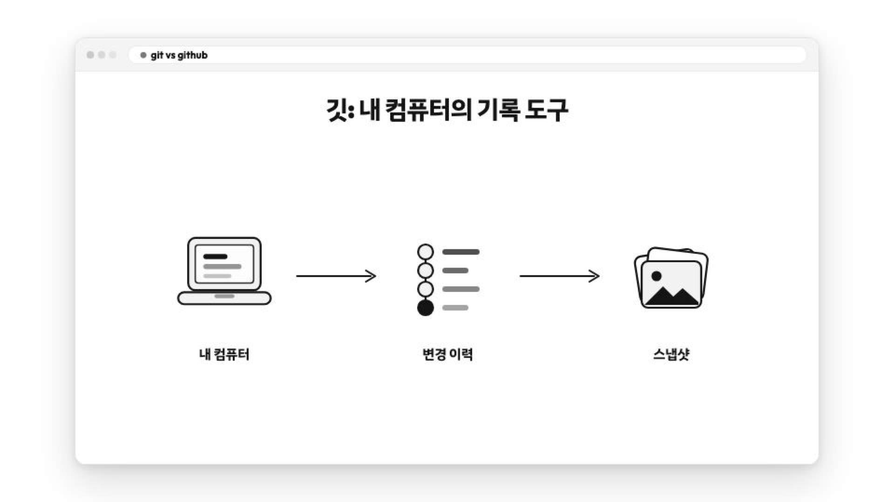
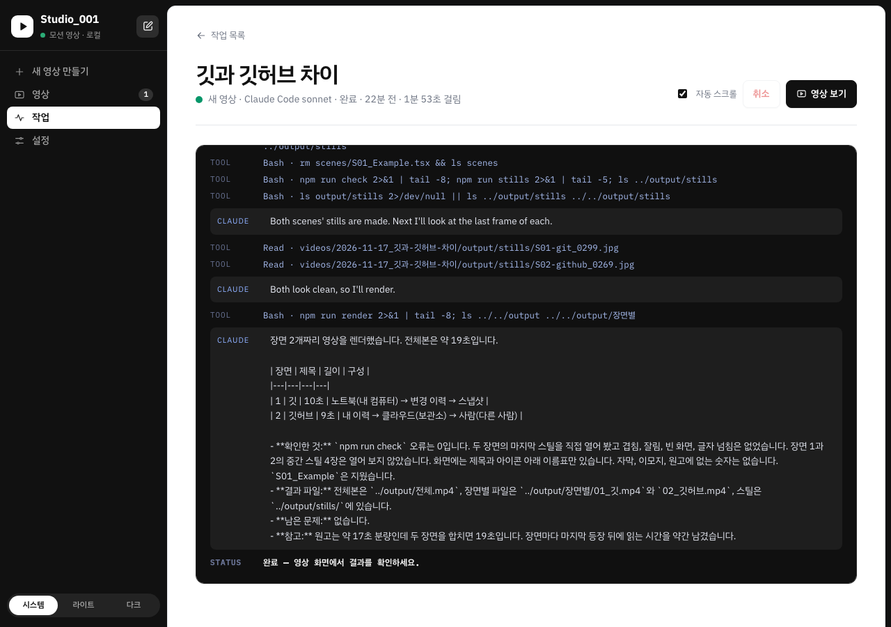

# Studio_001

글을 넣으면 흑백 그림 영상을 만들어 줍니다.

내 컴퓨터에서 돌아갑니다.



<br>

## 먼저 설치할 것

1. [Node.js](https://nodejs.org)

2. [Claude Code](https://claude.com/claude-code)

   설치한 뒤 로그인까지 해 둡니다.

<br>

## 1. 받기

터미널을 엽니다.

아래 세 줄을 한 줄씩 넣습니다.

```bash
git clone https://github.com/rainvibecode-blip/PART3_Motion.git
```

```bash
cd PART3_Motion
```

```bash
bash start.sh
```

<br>

## 2. 열기

브라우저 주소 칸에 아래 주소를 넣습니다.

```
http://localhost:3000
```

<br>

## 3. 글 넣기

제목을 씁니다.

원고를 붙여 넣습니다.

**만들기 시작**을 누릅니다.


<br>

## 4. 기다리기

**작업** 화면에 진행 상황이 나옵니다.

짧은 글은 2~3분 걸립니다.

처음 한 번은 몇 분 더 걸립니다.



<br>

## 5. 영상 보기

**영상** 화면에서 재생합니다.

**이 파일 받기**를 누르면 영상을 저장합니다.

<br>

## 6. 고치기

영상 화면 아래 **수정 요청** 칸에 고칠 내용을 글로 씁니다.

예: `두 번째 장면의 그림을 서버로 바꿔 줘`

<br>

## 끄기

터미널에서 `Ctrl` + `C`를 누릅니다.

<br>

## 자주 묻는 것

**돈이 드나요?**

따로 들지 않습니다. 내 Claude Code 로그인을 그대로 씁니다.

**만든 영상은 어디에 있나요?**

`videos` 폴더 안, `날짜_제목` 폴더의 `output`에 있습니다.

**마음대로 고쳐도 되나요?**

됩니다. 자유롭게 쓰고 고치세요.
